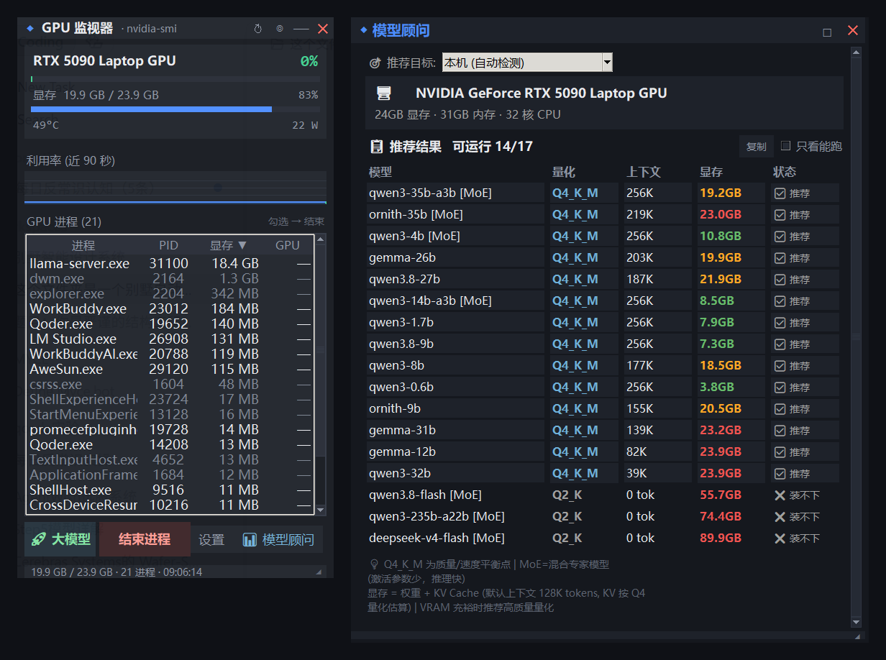

# GPU Monitor Panel — GPU 浮动监视面板 + 本地模型顾问

Windows 桌面悬浮 GPU 监视面板，内置**纯本地**的"模型顾问"推荐引擎：根据你机器的显存/内存/CPU，推荐该跑什么模型、什么量化、多大上下文。零第三方依赖，纯 Python 标准库。



## 功能特性

### 📊 GPU 浮动面板
- 实时显示 GPU 利用率、显存占用（nvidia-smi 优先，PDH 计数器兜底，也支持无 N 卡机器）
- 每进程 GPU 占用 / 显存占用列表，双击或右键结束进程
- **无边框窗口也能自由缩放**：右下角 `◢` 抓手 / 右边缘 / 下边缘拖动，双击恢复默认尺寸，尺寸自动记忆
- **进程表点击表头排序**：进程 / PID / 显存 / GPU，默认按显存降序（最占显存的排最前）
- 底部状态栏：显存占用 / 进程数 / 最后更新时间
- 标题栏 `↻` 手动刷新，不用等下一轮采集
- 边缘贴靠自动收起、悬浮球模式、透明度调节、置顶开关
- 系统托盘图标（实时显示占用率）、全局热键 `Ctrl+Alt+G` 呼出/隐藏
- 设置面板：刷新间隔、透明度、置顶，配置自动保存
- **高 DPI 自适应**：按系统字体缩放自动计算最小窗口宽度，不会把按钮/表格挤掉

### 🚀 大模型模式
一键结束所有非白名单的占显存进程（浏览器、后台录像等），为推理让出显存：
- 系统关键进程（dwm/explorer 等）自动保护，绝不误杀
- `python.exe / pythonw.exe`（ComfyUI、llama.cpp 等推理程序本身）默认保护
- 点击后先弹确认列表（进程名 + PID + 显存），不会静默杀进程

### 📈 模型顾问
纯本地计算，不联网、不上传任何数据：
- 内置 Qwen3 / Qwen3.8 / Gemma / Ornith / DeepSeek-V4 等模型架构数据
- 每个模型给出：**最优量化级别 + 最大上下文 + 显存拆解（权重 / KV cache）+ 速度估算**
- 适应度排序：Q4_K_M 甜点优先，最能打的排最前，装不下的垫底
- **窗口可缩放且表格自适应**：拉宽后五列按比例铺开，不再只多出右侧空白
- **「只看能跑」过滤**：一键隐藏装不下的模型
- **一键复制推荐结果**：制表符分隔，可直接粘进 Excel / 表格
- **多设备切换**：本机自动检测 / AMD Ryzen AI Max+ 395 (128G 统一内存) 等目标机一键切换
- 支持**实测锚点校准**：填入你在 Ollama 等工具里看到的实际模型体积，自动校准该模型所有量化级别的估算

## 环境要求

- Windows 10 / 11
- Python 3.8+（**无需 pip install 任何东西**，全部标准库）
- 可选：NVIDIA 显卡 + nvidia-smi（更精确的数据；无 N 卡走 PDH 兜底）

## 快速开始

```
git clone https://github.com/fanzhiang/gpu-monitor-panel.git
cd gpu-monitor-panel
```

双击 `GPU Panel.bat` 即可（自动寻找 pythonw，无黑窗）。

或手动：

```
pythonw gpu_monitor.py
```

## 开机自启

方式一（图形界面）：`Win+R` → `shell:startup` → 把 `GPU Panel.bat` 的快捷方式放进去。

方式二（注册表，无窗口）：

```bat
reg add HKCU\Software\Microsoft\Windows\CurrentVersion\Run /v GPUPanel /d "\"C:\path\to\pythonw.exe\" \"C:\path\to\gpu_monitor.py\"" /f
```

面板自带单实例互斥体，重复启动不会开两个。

## 模型顾问：实测校准

`model_advisor.py` 的 `MODELS` 字典支持给模型加实测权重锚点：

```python
"qwen3.8-27b": {
    ...
    "measured_weight_gb": {"Q4_K_M": 17.5},  # 你在 Ollama 里看到的实际体积
},
```

- 有锚点的模型，所有量化级别按比例自动校准（默认估算可能偏低 20%+）
- 非标准 KV 架构的模型（MLA / 线性注意力 / 稀疏注意力）可用显式 `kv_per_token_mb` 覆盖通用公式
- `ctx_native` 字段限制模型原生训练上下文（默认 256K）
- `DEVICES` 字典可登记自己的其他机器（如 128G 统一内存的 AMD 395）

## 文件说明

| 文件 | 说明 |
|------|------|
| `gpu_monitor.py` | 主程序：面板、托盘、热键、采集线程、进程管理 |
| `model_advisor.py` | 模型顾问引擎：模型库、量化估算、KV cache 公式 |
| `probe_sys.py` | 硬件探测（GPU/内存/CPU），输出 JSON |
| `GPU Panel.bat` | 启动脚本（自动找 pythonw，无黑窗） |
| `_gpu_tray.ico` | 托盘图标 |
| `autostart.cmd` | 可选：注册表自启用的包装脚本（带触发日志） |

运行期生成（已 gitignore）：`gpu_monitor_config.json`（位置/透明度）、`crash.log`（崩溃堆栈）、`autostart.log`（自启触发记录）。

## 常见问题

**Q: dwm.exe 占了 1-2G 显存还关不掉？**
正常。DWM 是桌面合成器，系统受保护进程（SYSTEM + PPL），无法禁用。想临时释放：管理员终端 `taskkill /F /IM dwm.exe`，屏幕黑 1 秒自动重启。长期减负：关闭透明效果 + 浏览器硬件加速，并把浏览器指到核显。

**Q: 面板开机自启了但不显示？**
先按 `Ctrl+Alt+G`；再看托盘；都不行就看 `crash.log`（程序崩溃会记完整堆栈）和 `autostart.log`（自启是否触发）。

**Q: 模型顾问推荐和我实测不符？**
用 `measured_weight_gb` 填实测锚点校准。不同运行时（llama.cpp / Ollama / vLLM）的 KV cache 策略差异很大，引擎默认假设 KV Q4 量化 + 混合注意力架构，可在模型条目里覆盖。

## 更新日志

### v1.1.0
- 修复：无边框窗口无法拉大 —— 主面板与模型顾问均支持拖动缩放（右下角抓手 / 右边缘 / 下边缘），双击恢复默认，尺寸自动记忆
- 修复：模型顾问内容不随窗口变宽 —— 表格改为 grid 布局，列宽按窗口比例分配
- 修复：窄窗口 / 高 DPI 下底部按钮被裁切 —— 最小宽度按按钮实际像素需求动态计算
- 修复：设备下拉框偶发空白（StringVar 被 GC 回收）
- 新增：进程表点击表头排序（进程 / PID / 显存 / GPU，升降序切换）
- 新增：底部状态栏（显存占用 / 进程数 / 更新时间）
- 新增：标题栏 `↻` 手动刷新
- 新增：模型顾问「只看能跑」过滤 + 一键复制推荐结果
- 优化：深色滚动条、显卡名自动换行、说明文案换行

### v1.0.0
- 首个版本：GPU 浮动面板 + 大模型模式 + 本地模型顾问

## License

MIT
